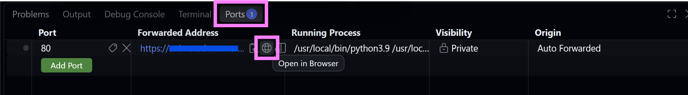

# How to run the model: improved instructions

## Run locally (no Docker required!)

- Create a virtual environment using python 3.9 using your environment manager of choice (with `uv`, this is `uv venv --python 3.9`)
- Install the corrected dependencies in requirements.txt into your virtual environment (with `uv`, use the command `uv pip install -r requirements.txt`)
- Activate the environment (with `uv` on a Windows machine, use the command `.venv/Scripts/activate.ps1`)
- Create an empty `data` folder in the root of the repository with `mkdir data`
- Run the model with `python index.py` or, with `uv`: `uv run python index.py`
- You should get a message in your terminal saying `Dash is running on http://some.numbers.go.here/`. Click on the http link to open the model interface in your browser.

## Run using GitHub codespaces

This way of running the model uses the Docker container specified in the repository.

- Click the button below to create a codespace with the Docker container

- Wait for the Codespace to be set up. This can take 5-10 minutes. You will know it is finished when it no longer says `Opening remote...` in the bottom left hand corner of the screen and instead says `>< Codespaces:`
- A message asking if you trust the owners of the files will appear. Click `Trust folder and continue`
- A popup will appear in the bottom right hand corner saying `Your application on a forwarded port is available`.
- Click on `Ports` and then the small globe 🌐 icon next to the URL, to open the model interface in a new window.

